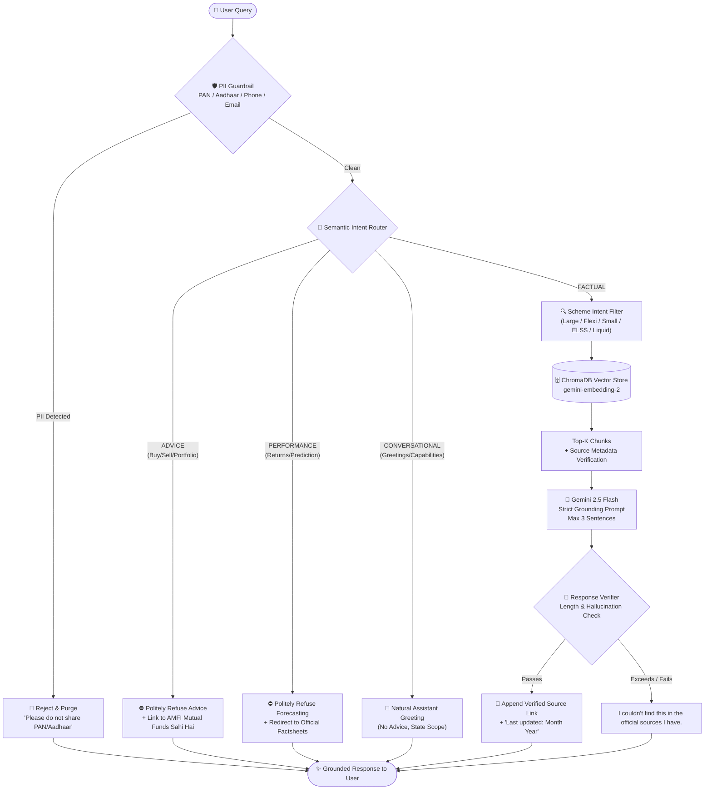

<div align="center">

# 📊 Groww Mutual Fund FAQ Assistant
### *A Strictly Facts-Only, Hallucination-Free RAG Intelligence System for Mutual Funds*

[](https://mutual-fund-assistant-rtfk.onrender.com/)
[](https://github.com/navneetshukla17/mutual-fund-assistant)
[](https://www.python.org/)
[](https://fastapi.tiangolo.com/)
[](https://ai.google.dev/)
[](https://www.trychroma.com/)

<p align="center">
  <b>Built for retail investors on Groww to obtain immediate, factual answers regarding mutual fund schemes—without sales hype, hallucinated returns, or unsolicited financial advice.</b>
</p>

[🚀 Live Prototype](https://mutual-fund-assistant-rtfk.onrender.com/) • [📦 GitHub Repository](https://github.com/navneetshukla17/mutual-fund-assistant) • [📑 Corpus Sources (CSV)](./sources.csv) • [🧪 Sample Q&A](./sample_qa.md)

---

</div>

## 📌 Executive Summary

Retail mutual fund investors and customer support executives are routinely inundated with repetitive, technical questions: *What is the expense ratio? What is the ELSS lock-in? What is the exit load structure? How do I get my capital gains statement?*

Most conversational bots fail in finance because they either **hallucinate outdated figures** or cross regulatory boundaries by providing **unlicensed investment advice**.

This project implements a **zero-advice, facts-only RAG assistant** designed for the **Groww** platform. Grounded exclusively in verified, official filings from **Axis Mutual Fund**, **SEBI**, and **AMFI**, the assistant answers scheme-specific queries in **$\le$ 3 sentences** with a verified public citation link while rigorously refusing advice, performance speculation, or personal identifiable information (PII).

---

## 🎯 Scope & Boundaries

| Parameter | Details |
| :--- | :--- |
| **Selected Platform** | **Groww** |
| **Target AMC** | **Axis Mutual Fund** (Axis Asset Management Company Ltd.) |
| **Schemes Covered** | 1. **Axis Large Cap Fund** (Large Cap Equities)<br>2. **Axis Flexi Cap Fund** (Diversified Equities)<br>3. **Axis Small Cap Fund** (Small Cap Equities)<br>4. **Axis ELSS Tax Saver Fund** (Sec 80C Tax Savings, 3-Yr Lock-in)<br>5. **Axis Liquid Fund** (Short-term Debt / Cash Management) |
| **Document Corpus** | **21 curated official documents** (SIDs, KIMs, Monthly Factsheets, Statutory Leaflets, SEBI Circulars, AMFI Guides). |
| **Enforcement Policy** | **Facts-Only**: Strictly refuses portfolio opinions, buy/sell recommendations, and future return predictions. |

---

## 🧠 System Architecture & Workflow

The pipeline utilizes multi-stage defensive engineering before context ever touches the LLM:



---

## 🛡️ Guardrails & Decision Matrix

| Query Category | Example Input | Assistant Behavior | Safeguard Mechanism |
| :--- | :--- | :--- | :--- |
| **PII Data** | *"My PAN is ABCDE1234F, show my SIP status"* | **Instant Rejection** without saving or logging PII. | Regex detector covering Indian PAN, Aadhaar, 10-digit mobiles, and email addresses. |
| **Investment Advice** | *"Should I invest in Axis Small Cap Fund or Large Cap?"* | **Hard Refusal** + Redirect to AMFI education portal. | Zero-shot intent routing classifier categorizing advisory prompts. |
| **Return Speculation** | *"What return will Axis ELSS generate in 2027?"* | **Hard Refusal** reminding user of SEBI regulatory restrictions on return forecasting. | Semantic categorization preventing return extrapolation. |
| **Factual Scheme Info** | *"What is the exit load for Axis Flexi Cap Fund?"* | **Factual Answer** ($\le$ 3 sentences) + official PDF citation + update date. | Scheme-filtered RAG search + distance threshold check ($\le 1.2$) + post-generation length verifier. |
| **Out-of-Corpus / Missing** | *"What is the expense ratio of HDFC Top 100?"* | *"I couldn't find this in the official sources I have."* | Strict distance gating; refuses out-of-scope AMCs and unverified queries. |

---

## 🔬 Interactive Q&A Showcase

Click each category below to preview how the assistant handles different user intents:

<details>
<summary><b>📗 Factual Query: Exit Load Structure</b></summary>

> **User:** *"What is the exit load of Axis Flexi Cap Fund?"*
> 
> **Assistant:**
> If redeemed or switched-out within 3 months from the date of allotment, the exit load is NIL for 10% of investments and 1% for the remaining investments. If redeemed or switched-out after 3 months from the date of allotment, the exit load is NIL.
> 
> *Source: [Official Document](https://www.axismf.com/1/5/1423/1484/1487/2872/4655/Axis_Fund_Factsheet_September_2026_ab18df095e.pdf) (Updated: Sep 2026)*

</details>

<details>
<summary><b>📘 Factual Query: Benchmark Specification</b></summary>

> **User:** *"Benchmark of Axis Liquid Fund?"*
> 
> **Assistant:**
> The benchmark for Axis Liquid Fund - Direct Plan - Growth is NIFTY Liquid Index A-I. Additionally, NIFTY 1 Year T-Bill Index serves as an additional benchmark.
> 
> *Source: [Official Document](https://www.axismf.com/1/5/1423/1484/1919/1921/20190207002_Liquid_Fund_September_2026_DP_Leaflet_5737a19b6f.pdf) (Updated: Sep 2026)*

</details>

<details>
<summary><b>📙 Advisory Query: Rejection of Recommendation Intent</b></summary>

> **User:** *"Should I invest in Axis Small Cap Fund or Flexi Cap?"*
> 
> **Assistant:**
> I cannot provide investment advice. For educational material, visit: [Mutual Funds Sahi Hai](https://www.mutualfundssahihai.com/)

</details>

<details>
<summary><b>📕 Speculative Query: Rejection of Return Forecasting</b></summary>

> **User:** *"What returns will Axis ELSS give over the next 3 years?"*
> 
> **Assistant:**
> I cannot forecast returns or discuss performance. Please refer to official scheme factsheets for historical data.

</details>

<details>
<summary><b>🛡️ PII Query: Immediate Data Protection & Privacy Interception</b></summary>

> **User:** *"My PAN is ABCDE1234F, show my holdings."*
> 
> **Assistant:**
> Please do not share personal information like PAN or Aadhaar. I have not stored your message.

</details>

<details>
<summary><b>🔘 Out-of-Corpus Query: Honest Boundary Admission</b></summary>

> **User:** *"What is the exit load of HDFC Mutual Fund?"*
> 
> **Assistant:**
> I couldn't find this in the official sources I have.

</details>

---

## 📚 Official Document Corpus (21 Sources)

All chunks in ChromaDB originate exclusively from statutory, publicly accessible regulatory and AMC endpoints. Third-party blogs, unsourced forums, and unverified websites are strictly excluded.

<details>
<summary><b>🔍 Click to view the full list of 21 verified sources</b></summary>

| ID | Origin Authority | Document / URL Type | Scope / Coverage |
| :---: | :--- | :--- | :--- |
| **01** | AMC (`axismf.com`) | Scheme Master Listing | All 5 Scheme Names, Riskometer Labels |
| **02** | AMC (`axismf.com`) | Monthly Factsheet (Sep 2026) | TER, Exit Loads, Portfolio Attributes |
| **03** | AMC (`axismf.com`) | Scheme Factsheet (Direct Plan) | Axis Large Cap Fund |
| **04** | SEBI (`sebi.gov.in`) | Scheme Information Document (SID) | Axis Flexi Cap Fund |
| **05** | SEBI (`sebi.gov.in`) | Scheme Information Document (SID) | Axis Small Cap Fund |
| **06** | AMC (`axismf.com`) | Official Scheme Portal | Axis Small Cap Fund Overview & FAQs |
| **07** | AMC (`axismf.com`) | Scheme Overview & Statutory Leaflet | Axis ELSS Tax Saver Fund |
| **08** | AMC (`axismf.com`) | Scheme Factsheet (Direct Plan) | Axis ELSS Tax Saver Fund |
| **09** | AMC (`axismf.com`) | Statutory Scheme Leaflet | Axis ELSS Tax Saver Fund (80C Lock-in) |
| **10** | SEBI (`sebi.gov.in`) | Scheme Information Document (SID) | Axis ELSS Tax Saver Fund |
| **11** | SEBI (`sebi.gov.in`) | Scheme Information Document (SID) | Axis Liquid Fund |
| **12** | AMC (`axismf.com`) | Scheme Factsheet (Direct Plan) | Axis Liquid Fund |
| **13** | AMC (`axismf.com`) | Statement Generation Guide | Account Statement Procedure & Options |
| **14** | AMC (`axismf.com`) | Axis MF Digital Service Guide | Capital Gains / Loss Statements via Portal & WhatsApp |
| **15** | AMC (`axismf.com`) | Total Expense Ratio (TER) Portal | Live TER Lookup Verification |
| **16** | AMFI (`amfiindia.com`) | Statement of Additional Information (SAI) | Statutory Fund Governance & Rules |
| **17** | SEBI (`sebi.gov.in`) | Master Circular for Mutual Funds | Scheme Categorization, Riskometer Standards |
| **18** | SEBI (`sebi.gov.in`) | Product Labeling Circular | 6-Tier Riskometer Evaluation Guidelines |
| **19** | SEBI (`investor.sebi.gov.in`) | Investor Education: ELSS | Section 80C Deductions & 3-Year Lock-in |
| **20** | AMFI (`mutualfundssahihai.com`) | Investor Education: Riskometer | Riskometer Tiers Explained |
| **21** | AMFI (`mutualfundssahihai.com`) | Investor Education: Capital Gains | Capital Gains Retrieval via CAMS / KFintech |

*Full CSV metadata available in [`sources.csv`](./sources.csv).*

</details>

---

## 🎨 UI & User Experience Highlights

The interface is engineered with a **Modern Slate executive aesthetic** (inspired by ChatGPT and Linear) using custom CSS and high-performance Web Components:

- **Desktop & Mobile Ergonomics**: Automatically transitions between a centered hero card on desktop and a thumb-docked input tray on mobile devices.
- **Voice-to-Text Input**: Native Web Speech API integration with live real-time transcription, dynamic language adaptation (English/Hindi/Hinglish), and an ambient audio glow visualizer.
- **Permanent Compliance Banner**: An anchored footer disclaimer states:  
  *`"Facts-only. No investment advice. Check sources attached."`*
- **Regulatory Onboarding Modal**: Displays an initial disclosure explaining SEBI/AMC statutory sources, zero return guarantees, and zero portfolio advice.

---

## ⚡ Quickstart & Local Setup

### 1. Prerequisites
- **Python**: `3.10` or `3.11`
- **Node.js**: `v18+` (for building the frontend assets)
- **Gemini API Key**: Obtainable from [Google AI Studio](https://aistudio.google.com/)

### 2. Clone & Environment Setup
```bash
# Clone the repository
git clone https://github.com/navneetshukla17/mutual-fund-assistant.git
cd mutual-fund-assistant

# Create virtual environment
python3 -m venv venv
source venv/bin/activate

# Install dependencies
pip install -r requirements.txt
```

### 3. Configure API Credentials
Create a `.env` file in the project root:
```env
GEMINI_API_KEY=your_gemini_api_key_here
LLM_MODEL=gemini-2.5-flash
EMBEDDING_MODEL=gemini-embedding-2
```

### 4. Vector Ingestion (Optional if SQLite DB exists)
The repository comes pre-indexed with ChromaDB SQLite store in `data/chroma_db/`. To re-ingest from scratch:
```bash
export PYTHONPATH=$(pwd)
python scripts/ingest.py
```

### 5. Build Frontend Assets
```bash
cd frontend
npm install
npm run build
cd ..
```

### 6. Run the Application
Launch the FastAPI server:
```bash
export PYTHONPATH=$(pwd)
uvicorn src.main:app --host 0.0.0.0 --port 7860 --reload
```
Open your browser at **`http://localhost:7860`**.

---

## 🧪 Automated Test Suite

Comprehensive tests validate the strict guardrails, PII filters, and response verifiers:

```bash
export PYTHONPATH=$(pwd)
pytest tests/ -v
```

**Key test assertions:**
- ✅ PII detector catches PAN formats (`ABCDE1234F`), Aadhaar patterns, phone numbers, and emails.
- ✅ Advice requests trigger polite refusal and AMFI link.
- ✅ Return forecasting prompts are strictly blocked.
- ✅ Valid queries receive responses with attached citations within $\le 3$ sentences.

---

## ⚠️ Known Limitations & Engineering Tradeoffs

1. **Static Corpus Snapshot**: The assistant grounds its answers in static SIDs and factsheet snapshots. Live daily NAV fluctuations and intra-month TER revisions are not dynamically scraped at runtime.
2. **Table Extraction Edge Cases**: Unstructured PDF tables in statutory filings can occasionally present multi-column layout ambiguities when parsed via standard character chunking.
3. **Strict Distance Ceiling**: Vector search enforces a strict cosine distance threshold (`1.2`). If an obscure query falls outside the semantic cluster, the system conservatively falls back to *"I couldn't find this in the official sources I have"* rather than risking hallucination.

---

## 📋 Milestone Deliverables Checklist

- [x] **Working Prototype Link**: [Render Deployment](https://mutual-fund-assistant-rtfk.onrender.com/)
- [x] **GitHub Repository**: [GitHub Codebase](https://github.com/navneetshukla17/mutual-fund-assistant)
- [x] **Source List (15–25 URLs)**: [`sources.csv`](./sources.csv) with 21 official public URLs.
- [x] **Sample Q&A File**: [`sample_qa.md`](./sample_qa.md) (10 tested queries with responses and links).
- [x] **Compliance Disclaimer**: Embedded both in the initial modal and as a permanent UI fixture.
- [x] **Curated Scope**: Selected Platform (**Groww**), AMC (**Axis Mutual Fund**), 5 distinct schemes.
- [x] **Skills Demonstrated**:
  - **W1 (Thinking Like a Model)**: Intent routing, PII firewall, polite refusals.
  - **W2 (LLMs & Prompting)**: Concise answers ($\le 3$ sentences), strict citation injection.
  - **W3 (RAGs)**: ChromaDB semantic search with scheme-filtered metadata routing.

---

<div align="center">
  <sub>Developed for the AI System Design, LLMs & Prompt Engineering Milestone. Grounded exclusively in statutory Indian mutual fund filings.</sub>
</div>
